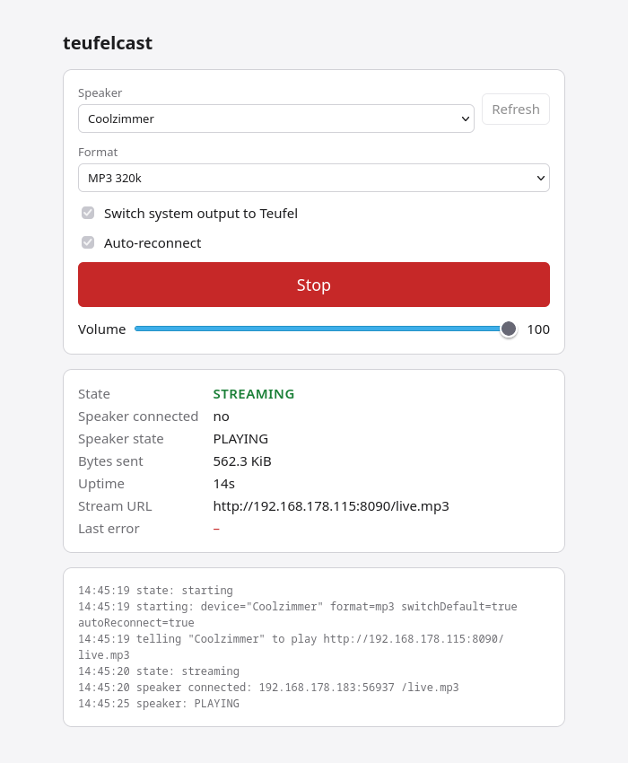
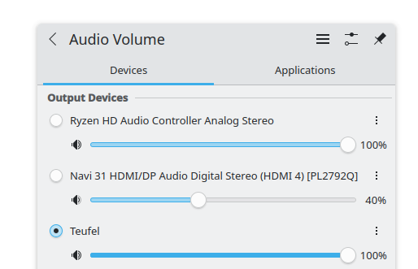

teufelcast
==========

DISCLAIMER: This was vibe coded, start to finish. It works on my machine.
If it sets your speaker on fire, you get to keep both pieces.

WHAT
----

Streams your desktop audio to a UPnP/DLNA renderer (written for a Teufel
Streamer, probably works with others).

It creates a PipeWire null sink called "teufel" and tells the speaker to
fetch http://<your-ip>:8090/live.mp3. Every request from the speaker gets
its own ffmpeg, which encodes the sink's monitor on the fly. There's a web
UI on 127.0.0.1:8091 with start/stop, a volume slider and a log.

Latency is a few seconds. Fine for music. Useless for video.

REQUIREMENTS
------------

- Linux with PipeWire and pipewire-pulse
- ffmpeg with libmp3lame (Fedora's ffmpeg-free has it)
- pactl (pulseaudio-utils)
- Go 1.24 or newer

The speaker has to be able to reach port 8090 on your box:

    sudo firewall-cmd --add-port=8090/tcp --permanent
    sudo firewall-cmd --reload

RUN
---

    go build -o teufelcast .
    ./teufelcast

Then open http://127.0.0.1:8091, pick the speaker, hit Start. Play music.

Flags:

    -device       speaker name             (default: Coolzimmer)
    -format       mp3, flac or wav         (default: mp3)
    -stream-port  port the speaker pulls   (default: 8090)
    -ui-addr      web UI address           (default: 127.0.0.1:8091)

For debugging:

    ./teufelcast -list                        # what speakers are out there
    ./teufelcast -formats -device Coolzimmer  # what that speaker accepts

Ctrl+C stops the speaker, restores your default output and removes the
sink. If it crashed and left the sink behind:

    pactl unload-module module-null-sink
